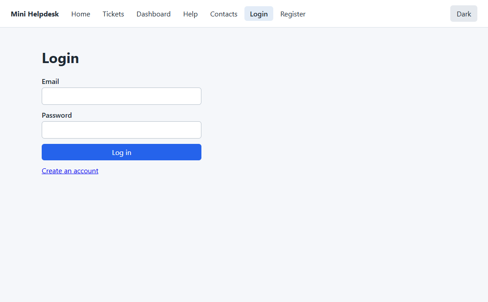
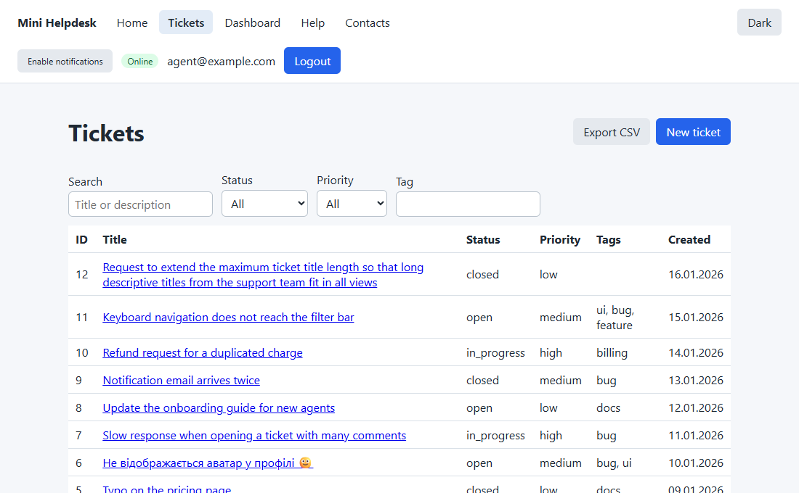
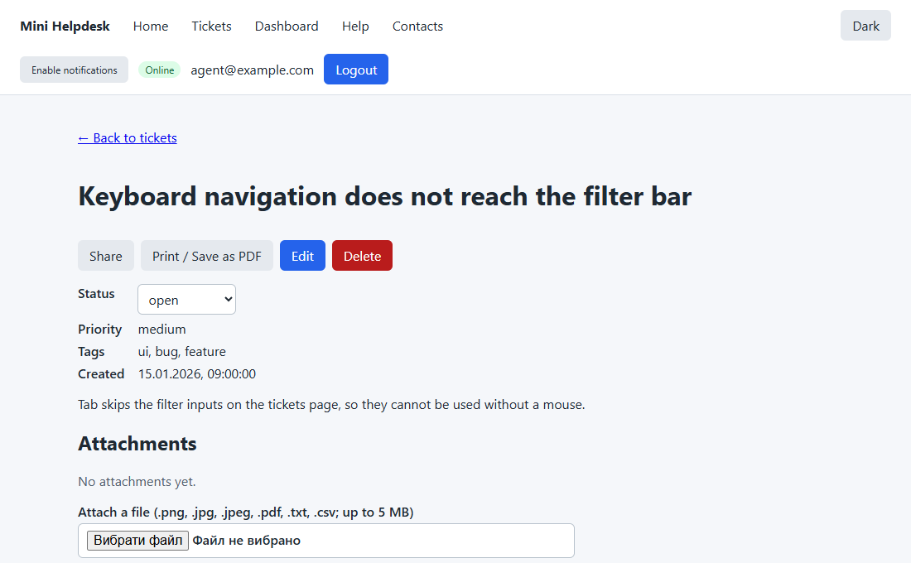
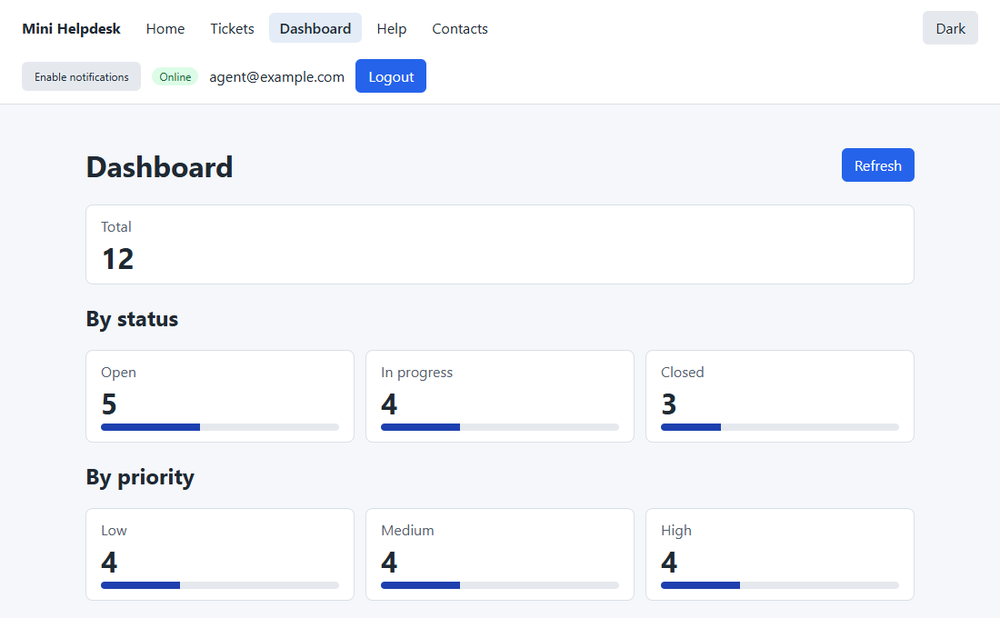
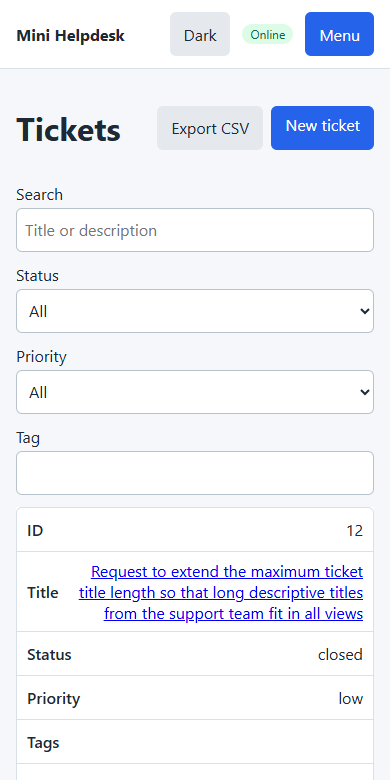
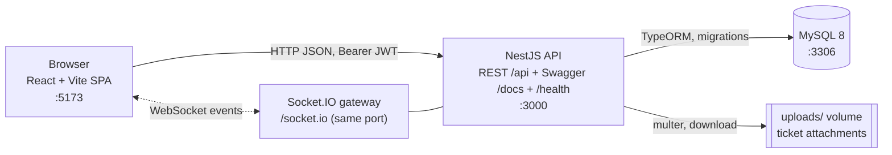
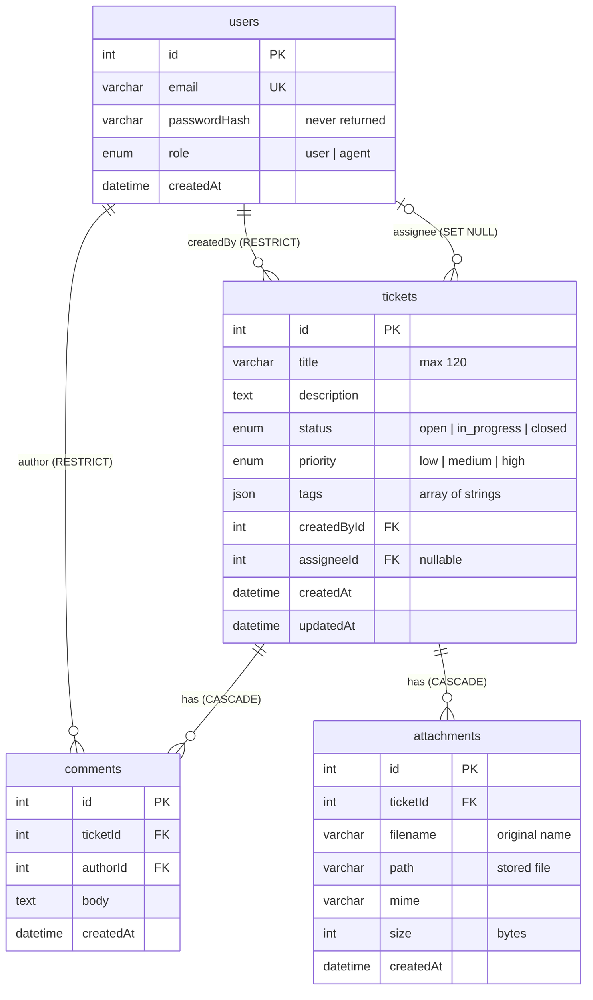

# Mini Helpdesk

[](https://github.com/ComeOnRoach/mini-helpdesk/actions/workflows/ci.yml)

A learning pet project: a ticketing system (NestJS + React + MySQL) in an npm-workspaces monorepo.
Users open tickets, discuss them in comments, attach files and get live updates; agents triage
tickets (status, assignee). The app is deliberately built **without test automation** and is
designed to be covered with Playwright later, so it is deterministic, has stable `data-testid`
locators and built-in testing aids (seed, Test API, slow/flaky modes, special pages).

| Login                                     | Tickets list                                       |
| ----------------------------------------- | -------------------------------------------------- |
|  |  |

| Ticket details                                         | Dashboard                                    |
| ------------------------------------------------------ | -------------------------------------------- |
|  |  |

Mobile layout (390 px wide):



## Contents

- [Quick start](#quick-start)
- [Architecture](#architecture)
- [Data model](#data-model)
- [Roles and permissions](#roles-and-permissions)
- [Test accounts](#test-accounts)
- [Pages](#pages)
- [API overview](#api-overview)
- [Real-time (WebSocket)](#real-time-websocket)
- [Environment variables](#environment-variables)
- [Test locators (data-testid)](#test-locators-data-testid)
- [Testing features](#testing-features)
- [Feature to Playwright map](#feature-to-playwright-map)
- [How to run](#how-to-run)
- [Repository structure](#repository-structure)
- [Troubleshooting](#troubleshooting)
- [Feature documentation](#feature-documentation)

## Quick start

Requirements: Git and Docker Desktop (Compose v2). Node.js is needed only for development without
Docker: use **Node 20 LTS** and npm 10+ (the API build with Nest CLI 12 fails on Node 22.14 with
`ERR_REQUIRE_CYCLE_MODULE`; the Docker images use Node 20).

```bash
git clone https://github.com/ComeOnRoach/mini-helpdesk.git
cd mini-helpdesk
cp .env.example .env        # PowerShell: Copy-Item .env.example .env
docker compose up
```

The first start takes a few minutes: the `api` and `web` containers run `npm install` into a shared
`node_modules` volume (if that first install fails, run `docker compose up` again, see
[Troubleshooting](#troubleshooting)). The stack is ready when the logs show the API listening on
port 3000 and Vite serving on port 5173.

The database starts empty. In a second terminal create the test accounts and demo tickets
(idempotent: running it again changes nothing):

```bash
docker compose exec api npm run seed -w apps/api
```

Now open http://localhost:5173/login and sign in with `agent@example.com` / `Agent123!` (see
[Test accounts](#test-accounts)).

| What    | URL                          | Expected                                                                                                                 |
| ------- | ---------------------------- | ------------------------------------------------------------------------------------------------------------------------ |
| Web     | http://localhost:5173        | The app with the navigation bar                                                                                          |
| API     | http://localhost:3000        | Base URL for the web client (all routes under `/api`)                                                                    |
| Swagger | http://localhost:3000/docs   | Interactive API docs (Authorize keeps the token after reload; `/api/test/*` is listed only when the Test API is enabled) |
| Health  | http://localhost:3000/health | `{"status":"ok","db":"up"}`                                                                                              |
| MySQL   | `localhost:3306`             | User, password and database from `.env`                                                                                  |

Stop and reset:

```bash
docker compose down        # stop, keep the database
docker compose down -v     # stop and wipe the database, node_modules and uploads volumes
```

## Architecture



- **Web** (`apps/web`): React, Vite, TypeScript, React Router. The API client adds
  `Authorization: Bearer <token>` and, on 401, clears the token and redirects to `/login`.
- **API** (`apps/api`): NestJS, TypeScript (strict), TypeORM, MySQL 8, JWT, bcrypt, Swagger.
  Business logic is in services; controllers stay thin. `synchronize` is off: the schema changes
  only through migrations, which run on API startup.
- **Real-time:** a Socket.IO gateway on the API port pushes `ticket.created`, `ticket.updated` and
  `comment.added` events to the logged-in clients.
- **Config** comes only from environment variables (`.env`, see
  [Environment variables](#environment-variables)).

## Data model

Derived from the TypeORM entities in `apps/api/src/*/*.entity.ts`. Tables use `utf8mb4` with the
`utf8mb4_unicode_ci` collation.



Details: [docs/features/entities.md](docs/features/entities.md) and
[docs/features/typeorm-mysql-migrations.md](docs/features/typeorm-mysql-migrations.md).

## Roles and permissions

Every API route requires a valid Bearer token unless it is public (`/api/auth/register`,
`/api/auth/login`, `/api/analytics/events`, `/api/csp-report`, `/health`, and the Test API, which
has its own `x-test-key` check). A missing, invalid or expired token gives 401; a valid token
without the required role gives 403.

| Action                                  | `user`                                     | `agent` |
| --------------------------------------- | ------------------------------------------ | ------- |
| Register, log in, `GET /auth/me`        | yes                                        | yes     |
| See tickets and comments                | only their own (others answer 404)         | all     |
| Create a ticket                         | yes (starts `open`, created by the caller) | yes     |
| Edit title, description, priority, tags | only their own                             | all     |
| Change ticket `status` and assignee     | no (403)                                   | yes     |
| Delete a ticket                         | only their own, and only while `open`      | any     |
| Comment, attach and delete files        | only on their own tickets                  | any     |
| Export CSV, `GET /api/stats`            | only their own tickets                     | all     |

New accounts created through `/register` always get the `user` role. Details:
[docs/features/jwt-and-role-guards.md](docs/features/jwt-and-role-guards.md) and
[docs/features/tickets-crud.md](docs/features/tickets-crud.md).

## Test accounts

Created by `npm run seed -w apps/api` (source: `apps/api/src/seed/seed.data.ts`). Development
credentials only.

| Email               | Password    | Role    |
| ------------------- | ----------- | ------- |
| `user@example.com`  | `User123!`  | `user`  |
| `agent@example.com` | `Agent123!` | `agent` |

The seed is deterministic (no randomness, fixed dates): 2 users, 12 tickets and 8 comments. Running
it again changes nothing. The seed needs `ts-node`, so it is a development command: the production
images do not contain it (see [Docker, production-like](#docker-production-like)). Details:
[docs/features/seed.md](docs/features/seed.md).

## Pages

Routes of the web app (`apps/web/src/app.tsx`). "Login" means a token is required; without one the
visitor is redirected to `/login`. An unknown URL shows the Not Found page.

| URL                           | Login | Description                                                                                                 |
| ----------------------------- | ----- | ----------------------------------------------------------------------------------------------------------- |
| `/`                           | no    | Home page                                                                                                   |
| `/login`                      | no    | Sign in                                                                                                     |
| `/register`                   | no    | Create a `user` account                                                                                     |
| `/tickets`                    | yes   | Ticket list: search, status/priority/tag filters, sorting and paging in the query string, CSV export        |
| `/tickets/new`                | yes   | Create a ticket (the form draft is kept in `sessionStorage`, key `ticketDraft`)                             |
| `/tickets/:id`                | yes   | Ticket details: status, comments (live), attachments (upload, download, delete), share, print, edit, delete |
| `/tickets/:id/edit`           | yes   | Edit a ticket                                                                                               |
| `/tickets/:id/print`          | yes   | Print page without header or navigation (`Print / Save as PDF`, A4 styles)                                  |
| `/share/:id`                  | yes   | Pop-up opened by the "Share" button: ticket link, copy to clipboard, close                                  |
| `/dashboard`                  | yes   | Ticket counters by status and priority from `GET /api/stats`                                                |
| `/help`                       | no    | FAQ in an iframe with a feedback form in a nested iframe (iframe inside iframe)                             |
| `/contacts`                   | no    | Three offices and a "Nearest office" button using the geolocation API                                       |
| `/robots.txt`, `/sitemap.xml` | no    | Static service files from `apps/web/public/`                                                                |

Other behaviours: a light/dark theme toggle in the header (`localStorage` key `theme`), a burger
menu and ticket cards at 768 px and below, and optional analytics requests
(`POST /api/analytics/events`, switched by `VITE_ANALYTICS_ENABLED`). Every screen has loading,
empty and error states. Web storage keys: `token` (localStorage), `theme` (localStorage),
`ticketDraft` (sessionStorage).

Feature details live in `docs/features/` ([index](#feature-documentation)): for example
[tickets-ui](docs/features/tickets-ui.md), [nested-iframes](docs/features/nested-iframes.md),
[popup-share](docs/features/popup-share.md),
[contacts-geolocation](docs/features/contacts-geolocation.md),
[stats-dashboard](docs/features/stats-dashboard.md), [ticket-print](docs/features/ticket-print.md),
[responsive-mobile](docs/features/responsive-mobile.md),
[theme-switcher](docs/features/theme-switcher.md),
[analytics-events](docs/features/analytics-events.md),
[robots-sitemap](docs/features/robots-sitemap.md).

## API overview

All routes are under the `/api` prefix; only `/health` and `/docs` are outside it. The complete,
always current reference is Swagger at http://localhost:3000/docs. Errors always look like
`{ statusCode, error, message, path, timestamp }` (the `/health` 503 is the one exception); see
[docs/features/validation-error-format.md](docs/features/validation-error-format.md).

| Method | Path                                         | Who                                                                                                                       |
| ------ | -------------------------------------------- | ------------------------------------------------------------------------------------------------------------------------- |
| POST   | `/api/auth/register`                         | public; creates a `user` (409 if the email exists)                                                                        |
| POST   | `/api/auth/login`                            | public; `{ accessToken, user }` (401 on bad login)                                                                        |
| GET    | `/api/auth/me`                               | any logged-in user                                                                                                        |
| GET    | `/api/tickets`                               | list; `?page=&limit=&status=&priority=&tag=&q=&sort=createdAt:desc`                                                       |
| POST   | `/api/tickets`                               | any logged-in user                                                                                                        |
| GET    | `/api/tickets/export`                        | CSV of the filtered list (UTF-8 with BOM, `tickets-YYYY-MM-DD.csv`)                                                       |
| GET    | `/api/tickets/:id`                           | owner or agent; includes comments and attachments                                                                         |
| PATCH  | `/api/tickets/:id`                           | owner or agent; only an agent may send `status` or `assigneeId` (else 403)                                                |
| DELETE | `/api/tickets/:id`                           | agent, or the author while the ticket is `open`                                                                           |
| POST   | `/api/tickets/:id/comments`                  | owner or agent; body 1 to 2000 characters                                                                                 |
| GET    | `/api/tickets/:id/comments`                  | owner or agent; `?page=&limit=`, oldest first, `{ items, total, page, limit }`                                            |
| POST   | `/api/tickets/:id/attachments`               | owner or agent; multipart field `file`; png, jpg, pdf, txt, csv; up to `MAX_UPLOAD_BYTES` (413 too large, 415 wrong type) |
| DELETE | `/api/tickets/:id/attachments/:attachmentId` | owner or agent                                                                                                            |
| GET    | `/api/attachments/:id/download`              | owner or agent; original file name, `Content-Disposition: attachment`                                                     |
| GET    | `/api/stats`                                 | `{ total, open, in_progress, closed, byPriority }` (agent: all, user: own)                                                |
| POST   | `/api/analytics/events`                      | public; `{ event, page, ts }`, answers 204, stores nothing                                                                |
| POST   | `/api/csp-report`                            | public; CSP violation reports, logged, answers 204                                                                        |
| GET    | `/health`                                    | public; `{"status":"ok","db":"up"}`                                                                                       |

Feature documents: [auth](docs/features/auth-register-login.md),
[tickets list](docs/features/tickets-list.md), [tickets CRUD](docs/features/tickets-crud.md),
[comments](docs/features/comments.md), [attachments](docs/features/attachments.md),
[CSV export](docs/features/tickets-export-csv.md), [Swagger](docs/features/swagger-docs.md).

## Real-time (WebSocket)

Socket.IO on the API port (`ws://localhost:3000/socket.io/`). Full description:
[docs/features/websocket-gateway.md](docs/features/websocket-gateway.md).

**Connect** with the login token: `io(url, { auth: { token } })` (an `Authorization: Bearer <token>`
header also works). A missing, invalid or expired token, or a deleted user, gives `connect_error`
with the message `Unauthorized`.

**Rooms.** Every socket is in `user:<id>`; an agent is also in `agents`. Send `ticket.subscribe`
`{ "ticketId": 5 }` to join `ticket:5` (and `ticket.unsubscribe` to leave). Both answer with an ack:
`{ "ok": true }` or `{ "ok": false, "message": "..." }`. Someone else's ticket answers
`Ticket not found`, like a missing one.

**Server events** (a `user` only receives events of their own tickets; an agent receives all):

| Event            | Sent to                                          | Payload                                                |
| ---------------- | ------------------------------------------------ | ------------------------------------------------------ |
| `ticket.created` | `agents`, `user:<creator>`                       | `{ ticket }`                                           |
| `ticket.updated` | `agents`, `user:<creator>`, `ticket:<id>`        | `{ ticket, changedFields: string[], actorId: number }` |
| `comment.added`  | `ticket:<id>`, `agents`, `user:<ticket creator>` | `{ ticketId, comment }`                                |

**In the web app** ([realtime-ui](docs/features/realtime-ui.md)): the socket opens after login and
closes on logout. A toast "New comment on ticket #N" links to the ticket, an unread badge sits on
the Tickets link (`nav-unread-badge`), comments appear live on the open ticket, and a connection
indicator shows `data-status` = `connecting` / `online` / `reconnecting` / `offline`
(`nav-connection`). [Browser notifications](docs/features/browser-notifications.md): the header
shows the permission (`nav-notifications`, `data-permission` = `default` / `granted` / `denied` /
`unsupported`); with permission, a comment from someone else while the tab is hidden shows a system
notification.

## Environment variables

Every variable from [.env.example](.env.example). Copy it to `.env` (never commit `.env`).
Docker Compose passes the relevant values to the containers. Vite reads env files from `apps/web`,
not from the repository root, so for local development without Docker put `VITE_*` values in
`apps/web/.env` (git-ignored).

| Variable                 | Default                     | Purpose                                                                                                                      |
| ------------------------ | --------------------------- | ---------------------------------------------------------------------------------------------------------------------------- |
| `DB_HOST`                | `localhost`                 | MySQL host (Compose overrides it to `db` for the api)                                                                        |
| `DB_PORT`                | `3306`                      | MySQL port (also the host port published by `docker-compose.yml`)                                                            |
| `DB_USER`                | `helpdesk`                  | MySQL application user                                                                                                       |
| `DB_PASSWORD`            | `helpdesk`                  | MySQL application password                                                                                                   |
| `DB_ROOT_PASSWORD`       | `root`                      | MySQL root password (used by the image and its healthcheck)                                                                  |
| `DB_NAME`                | `helpdesk`                  | Database name                                                                                                                |
| `JWT_SECRET`             | `change-me`                 | JWT signing secret; set a strong value outside development                                                                   |
| `JWT_EXPIRES_IN`         | `1h`                        | Access token lifetime (`15m`, `1h`, `7d`)                                                                                    |
| `NODE_ENV`               | `development`               | Runtime environment. `production` hides stack traces and disables the Test API; `test` enables the Test API                  |
| `PORT`                   | `3000`                      | API listen port                                                                                                              |
| `WEB_ORIGIN`             | `http://localhost:5173`     | Origin allowed by API CORS                                                                                                   |
| `UPLOAD_DIR`             | empty (`<api cwd>/uploads`) | Folder for ticket attachments (Compose sets `/app/uploads`, a named volume)                                                  |
| `MAX_UPLOAD_BYTES`       | `5242880`                   | Attachment size limit in bytes (5 MB)                                                                                        |
| `VITE_API_URL`           | `http://localhost:3000`     | API base URL used by the web app (baked into the bundle at build time in the production image)                               |
| `VITE_ANALYTICS_ENABLED` | `true`                      | `true` sends `POST /api/analytics/events` on key actions; any other value turns it off                                       |
| `BASE_URL`               | `http://localhost:5173`     | Playwright only (`e2e/`, future): web app URL. Not read by the API or web app                                                |
| `API_URL`                | `http://localhost:3000`     | Playwright only: API base URL. Not read by the API or web app                                                                |
| `TEST_API_KEY`           | empty                       | Secret for the `x-test-key` header of the Test API (required when the Test API is on); Playwright sends the same value       |
| `WEB_PORT`               | `5173`                      | Host port of the web container in `docker-compose.prod.yml` (nginx listens on 8080 inside)                                   |
| `CSP_ENABLED`            | `false`                     | `true` sends a `Content-Security-Policy` header from the API (helmet) and from the web dev/preview server and the prod nginx |
| `CSP_REPORT_ONLY`        | `false`                     | With `CSP_ENABLED=true`, `true` sends `Content-Security-Policy-Report-Only` instead (violations are reported, not blocked)   |
| `ENABLE_TEST_API`        | `false`                     | `true` (or `NODE_ENV=test`) registers `/api/test/*`; ignored when `NODE_ENV=production`                                      |
| `SLOW_API_MS`            | `0`                         | Delay in ms (0-60000) added to API responses; `0` = off                                                                      |
| `FLAKY_RATE`             | `0`                         | Chance (0-1) that `GET /api/tickets` fails with a random 500; `0` = off                                                      |

Invalid values stop the API at startup with a validation message.

## Test locators (data-testid)

Every interactive element in the web app has a `data-testid`, so tests do not depend on text or CSS.
Playwright reads `data-testid` by default (`getByTestId`).

- **Format:** `kebab-case`, `<page>-<element>`: `login-email`, `login-submit`, `ticket-form-title`,
  `ticket-details-delete`.
- **List rows:** `data-testid="ticket-row"` plus `data-ticket-id="<id>"` (comments: `comment-item`
  plus `data-comment-id`).
- **No duplicates** on one page, except list rows.
- **Do not rename** existing testids without a reason; tests will depend on them.
- **Shared widgets:** toast `toast` (`data-toast-type`), modal `confirm-modal`,
  `confirm-modal-confirm`, `confirm-modal-cancel`; states `<prefix>-loading`, `<prefix>-empty`,
  `<prefix>-error`, `<prefix>-retry`; pagination `<prefix>-page-prev`, `<prefix>-page-next`.
- **State attributes:** `data-status` (connection), `data-permission` (notifications),
  `data-nearest`, `data-error-kind`, `data-toast-type`, `data-value` (dashboard counters).
- **Enforced by lint:** `npm run lint` fails if a `button`, `input`, `select`, `textarea`, `form`,
  `Link` or `NavLink` in `apps/web/src` has no `data-testid`.
- **Pull requests:** use the checklist in `.github/pull_request_template.md`.

More detail: [docs/features/data-testid.md](docs/features/data-testid.md).

## Testing features

Built-in aids for future automated tests. All are off or harmless by default.

| Feature            | How to use                                                                                              | Documentation                                                                  |
| ------------------ | ------------------------------------------------------------------------------------------------------- | ------------------------------------------------------------------------------ |
| Deterministic seed | `npm run seed -w apps/api`; fixed accounts, no `Math.random`                                            | [seed](docs/features/seed.md)                                                  |
| Test API           | `/api/test/reset`, `/api/test/seed`, `/api/test/users`; header `x-test-key`                             | [test-api](docs/features/test-api.md)                                          |
| Slow API           | `SLOW_API_MS=2000` delays responses; `x-delay-ms` header per request                                    | [slow-api-flaky-mode](docs/features/slow-api-flaky-mode.md)                    |
| Flaky API          | `FLAKY_RATE=0.3` makes `GET /api/tickets` fail randomly with a 500                                      | [slow-api-flaky-mode](docs/features/slow-api-flaky-mode.md)                    |
| Special pages      | `/help` (iframe in iframe), `/share/:id` (pop-up), `/contacts` (geolocation), `/dashboard`, print page  | see [Pages](#pages)                                                            |
| Service files, CSP | `/robots.txt`, `/sitemap.xml`; `CSP_ENABLED`, `CSP_REPORT_ONLY`; violation reports to `/api/csp-report` | [robots-sitemap](docs/features/robots-sitemap.md), [csp](docs/features/csp.md) |
| Analytics requests | `POST /api/analytics/events` on key actions (switch: `VITE_ANALYTICS_ENABLED`); never breaks the UI     | [analytics-events](docs/features/analytics-events.md)                          |

### Test API (`/api/test`)

Registered **only** when `ENABLE_TEST_API=true` or `NODE_ENV=test`, and never when
`NODE_ENV=production` (the routes do not exist: they answer 404 and are absent from Swagger).
Every call needs the header `x-test-key: <TEST_API_KEY>` (missing or wrong gives 401); the API will
not start with the Test API on and no `TEST_API_KEY`.

- `POST /api/test/reset` empties comments, attachments, tickets and users (ids restart at 1),
  deletes uploaded files, then re-runs the deterministic seed. It refuses to run unless `DB_NAME`
  contains `test`: use a dedicated database.
- `POST /api/test/seed` `{ "tickets": 5, "status": "open" }` adds deterministic `Test ticket N`
  tickets (optional `priority`, `createdBy`); needs the base users (otherwise 409: call reset first).
- `POST /api/test/users` `{ "email", "password", "role" }` creates a user (409 if the email exists).

### Slow and flaky API

- `SLOW_API_MS=2000` delays API responses by 2 s (not `/health`, `/api/analytics/*`,
  `/api/test/*`).
- `FLAKY_RATE=0.3` makes `GET /api/tickets` (the list only) fail with a 500 in the usual error
  format with probability 0.3. It is random on purpose; use `0` or `1` for exact behaviour.
- `x-delay-ms: <ms>` header replaces `SLOW_API_MS` for one request (max 10000); honoured only when
  `NODE_ENV=test` or `ENABLE_TEST_API=true`.

The tickets page shows loading, then an error with a Retry button (`tickets-retry`).

### Content-Security-Policy

Off by default. `CSP_ENABLED=true` adds a `Content-Security-Policy` header to API responses
(helmet, CSP only) and to the web dev/preview server (Vite plugin) and the production nginx;
`CSP_REPORT_ONLY=true` switches to `Content-Security-Policy-Report-Only`. Violations are POSTed to
`POST /api/csp-report`. Swagger `/docs` gets a relaxed policy.

## Feature to Playwright map

A hint for the future test suite: which project feature to use for each Playwright topic. The Status column tracks the automated tests themselves (`not started` / `done`); no tests exist yet. The same table is in [e2e/README.md](e2e/README.md).

| Playwright topic                      | Project feature                                                                              | Task                                                                                                                                          | What to check                                        | Feature doc                                                                                                                                       | Status      |
| ------------------------------------- | -------------------------------------------------------------------------------------------- | --------------------------------------------------------------------------------------------------------------------------------------------- | ---------------------------------------------------- | ------------------------------------------------------------------------------------------------------------------------------------------------- | ----------- |
| Page Object Model                     | Login, Tickets, Ticket details, forms (`/login`, `/tickets`, `/tickets/:id`, `/tickets/new`) | [T2.4](docs/tasks/T2.4-frontend-auth-pages.md), [T3.4](docs/tasks/T3.4-frontend-tickets-ui.md)                                                | one class per page, `getByTestId` locators           | [frontend-auth](docs/features/frontend-auth.md), [tickets-ui](docs/features/tickets-ui.md)                                                        | not started |
| Upload (`setInputFiles`)              | Ticket attachments                                                                           | [T4.1](docs/tasks/T4.1-attachments-upload.md)                                                                                                 | file input, size and type limits, delete             | [attachments](docs/features/attachments.md)                                                                                                       | not started |
| Download (`waitForEvent('download')`) | Attachments, CSV export                                                                      | [T4.2](docs/tasks/T4.2-attachments-download.md), [T4.3](docs/tasks/T4.3-export-csv.md)                                                        | suggested filename, file content                     | [attachments](docs/features/attachments.md), [tickets-export-csv](docs/features/tickets-export-csv.md)                                            | not started |
| PDF / print emulation                 | Ticket print page (`/tickets/:id/print`)                                                     | [T4.4](docs/tasks/T4.4-print-page-pdf.md)                                                                                                     | `page.pdf()`, `emulateMedia({ media: 'print' })`     | [ticket-print](docs/features/ticket-print.md)                                                                                                     | not started |
| Geolocation                           | Nearest office (`/contacts`)                                                                 | [T6.3](docs/tasks/T6.3-geolocation-nearest-office.md)                                                                                         | `geolocation` and `permissions` context options      | [contacts-geolocation](docs/features/contacts-geolocation.md)                                                                                     | not started |
| Permissions                           | Browser notifications                                                                        | [T5.3](docs/tasks/T5.3-browser-notifications.md)                                                                                              | `grantPermissions`, stubbing `Notification`          | [browser-notifications](docs/features/browser-notifications.md)                                                                                   | not started |
| Mobile emulation                      | Responsive layout                                                                            | [T6.4](docs/tasks/T6.4-responsive-mobile.md)                                                                                                  | viewport, `devices`, burger menu at 768 px           | [responsive-mobile](docs/features/responsive-mobile.md)                                                                                           | not started |
| Pop-ups / new windows                 | Share (`/share/:id`)                                                                         | [T6.2](docs/tasks/T6.2-popup-share.md)                                                                                                        | `waitForEvent('popup')`, clipboard                   | [popup-share](docs/features/popup-share.md)                                                                                                       | not started |
| iframe / nested frames                | `/help` (iframe inside iframe)                                                               | [T6.1](docs/tasks/T6.1-nested-iframes.md)                                                                                                     | chained `frameLocator`                               | [nested-iframes](docs/features/nested-iframes.md)                                                                                                 | not started |
| Block / intercept / modify requests   | Analytics events, `/dashboard` (`/api/stats`)                                                | [T6.5](docs/tasks/T6.5-analytics-requests.md), [T7.5](docs/tasks/T7.5-stats-dashboard.md)                                                     | `page.route`, `waitForRequest`, mocked stats         | [analytics-events](docs/features/analytics-events.md), [stats-dashboard](docs/features/stats-dashboard.md)                                        | not started |
| WebSockets                            | Real-time comments, toasts, unread badge                                                     | [T5.1](docs/tasks/T5.1-websocket-gateway.md), [T5.2](docs/tasks/T5.2-realtime-ui-toast.md)                                                    | `page.on('websocket')`, two browser contexts         | [websocket-gateway](docs/features/websocket-gateway.md), [realtime-ui](docs/features/realtime-ui.md)                                              | not started |
| localStorage / sessionStorage         | Token, theme, create-form draft                                                              | [T2.4](docs/tasks/T2.4-frontend-auth-pages.md), [T6.6](docs/tasks/T6.6-theme-switcher.md), [T3.5](docs/tasks/T3.5-draft-in-sessionstorage.md) | keys `token`, `theme`, `ticketDraft`; `storageState` | [frontend-auth](docs/features/frontend-auth.md), [theme-switcher](docs/features/theme-switcher.md), [ticket-draft](docs/features/ticket-draft.md) | not started |
| robots.txt                            | Service files (`robots.txt`, `sitemap.xml`)                                                  | [T7.1](docs/tasks/T7.1-robots-sitemap.md)                                                                                                     | `request` fixture, content checks                    | [robots-sitemap](docs/features/robots-sitemap.md)                                                                                                 | not started |
| CSP                                   | helmet on the API, Vite plugin on the web                                                    | [T7.2](docs/tasks/T7.2-csp-helmet.md)                                                                                                         | response headers, console, `POST /api/csp-report`    | [csp](docs/features/csp.md)                                                                                                                       | not started |
| Retries / flaky / timeouts            | Slow API, flaky mode (`SLOW_API_MS`, `FLAKY_RATE`, `x-delay-ms`)                             | [T7.4](docs/tasks/T7.4-slow-api-flaky-mode.md)                                                                                                | timeouts, auto-wait, `retries`                       | [slow-api-flaky-mode](docs/features/slow-api-flaky-mode.md)                                                                                       | not started |
| Tags (`@smoke`, `@regression`)        | All scenarios                                                                                | -                                                                                                                                             | `--grep`, a tag per test                             | -                                                                                                                                                 | not started |
| Debug / codegen / trace               | All features                                                                                 | -                                                                                                                                             | `codegen`, `--debug`, `trace: 'on-first-retry'`      | -                                                                                                                                                 | not started |
| Test data isolation                   | Test API (`/api/test/reset`, `/seed`, `/users`)                                              | [T7.3](docs/tasks/T7.3-test-endpoints-reset-seed.md)                                                                                          | `beforeEach` reset, `x-test-key`                     | [test-api](docs/features/test-api.md)                                                                                                             | not started |

## How to run

### Docker, development

The [Quick start](#quick-start): `docker compose up` runs MySQL, the API (`nest start --watch`) and
Vite with hot reload from your working tree. `docker-compose.override.yml` is loaded automatically
and makes the file watchers poll, which is needed for Windows bind mounts. Seed with
`docker compose exec api npm run seed -w apps/api`.

### Docker, production-like

`docker-compose.prod.yml` builds both images from the Dockerfiles (no bind mounts, no hot reload).
It is standalone and does not use `docker-compose.yml` or the override file:

```bash
docker compose -f docker-compose.prod.yml up --build
```

- API: `apps/api/Dockerfile`, Node 20 on alpine, non-root, about 230 MB; `NODE_ENV` defaults to
  `production`, so the Test API is off. It is published on `PORT` (default 3000).
- Web: `apps/web/Dockerfile`, a Vite build served by unprivileged nginx (8080 inside the container),
  published on `WEB_PORT` (default 5173). The container sets the CSP header from `CSP_ENABLED` /
  `CSP_REPORT_ONLY`.
- `VITE_API_URL` is baked into the web bundle at build time and must be the address the browser
  uses for the API.
- The images do not contain the seed (it needs `ts-node`): create accounts at `/register` (they get
  the `user` role). Migrations run on API startup.

Details: [docs/features/dockerfiles.md](docs/features/dockerfiles.md).

### Local, without Docker

Run only the database in Docker and the apps on the host (Node 20):

```bash
cp .env.example .env                 # DB_HOST=localhost is the default
docker compose up -d db              # MySQL on localhost:3306
npm install                          # dependencies for all workspaces
npm run start:dev -w apps/api        # API with hot reload on :3000 (applies migrations)
npm run seed -w apps/api             # accounts and demo tickets
npm run dev -w apps/web              # web dev server on :5173
```

To point the web app at a different API, create `apps/web/.env` (git-ignored) with
`VITE_API_URL=http://localhost:3000`.

Other commands:

```bash
npm run lint       # ESLint
npm run format     # Prettier
npm run build      # build api and web
```

Database migrations (inside the container use `docker compose exec api <command>`):

```bash
npm run migration:generate -w apps/api -- src/migrations/<Name>
npm run migration:run -w apps/api
npm run migration:revert -w apps/api
```

### CI

`.github/workflows/ci.yml` runs on every pull request and on pushes to `main`; a new push cancels
the stale run of the same ref. All jobs use Node 20.

| Job      | What it does                                                                                                                                                                                           |
| -------- | ------------------------------------------------------------------------------------------------------------------------------------------------------------------------------------------------------ |
| `api`    | `npm ci`, lint, API build; against a real MySQL 8 service: migrations, seed, starts the API and waits for `/health` with `db: up`; builds the web and starts the Vite preview; uploads logs on failure |
| `web`    | `npm ci`, lint, web build                                                                                                                                                                              |
| `docker` | Builds the API and web production images, fails if the API image is 300 MB or more or if either image runs as root                                                                                     |
| `e2e`    | Commented-out placeholder for the future Playwright suite (see [e2e/README.md](e2e/README.md))                                                                                                         |

Details: [ci-lint-build](docs/features/ci-lint-build.md), [ci-mysql-service](docs/features/ci-mysql-service.md),
[dockerfiles](docs/features/dockerfiles.md), [e2e-placeholder](docs/features/e2e-placeholder.md).

## Repository structure

```
mini-helpdesk/
├─ apps/
│  ├─ api/                    NestJS API (auth, tickets, comments, attachments, realtime, stats, Test API, ...)
│  └─ web/                    React + Vite app (routes, layout, API client, static widgets in public/)
├─ docs/
│  ├─ tasks/                  task files T0.1-T9.3 and 00-INDEX.md
│  ├─ features/               one document per finished feature
│  └─ screenshots/            images used in this README
├─ docker-compose.yml         dev stack: db + api + web with hot reload
├─ docker-compose.override.yml  dev file watching (polling) for Windows bind mounts
├─ docker-compose.prod.yml    production-like stack built from the Dockerfiles
├─ .env.example               all environment variables with defaults
├─ eslint.config.mjs          ESLint (flat config), Prettier settings in .prettierrc
├─ CLAUDE.md                  project rules
├─ e2e/                       Playwright placeholder (README only, no tests)
└─ .github/                   CI workflow and pull request template
```

## Troubleshooting

- **Cannot log in right after `docker compose up`:** the database is empty until you run the seed
  (`docker compose exec api npm run seed -w apps/api`), or register a new account at `/register`.
- **Port already in use** (3000, 3306 or 5173): stop the other process, or change `PORT` / `DB_PORT`
  in `.env` (the web port 5173 is fixed in `docker-compose.yml`).
- **`api` keeps waiting:** it starts only after MySQL is healthy, which can take about 30 seconds
  on the first run.
- **First start fails during `npm install`:** `api` and `web` install into one shared
  `node_modules` volume at the same time; run `docker compose up` again (or restart the `api`
  container).
- **No hot reload on Windows:** file watchers poll through `docker-compose.override.yml`; make sure
  the override file is not deleted.
- **`nest build` fails with `ERR_REQUIRE_CYCLE_MODULE`:** you are on Node 22.14; use Node 20 or Docker.
- **Web calls the wrong API:** check `VITE_API_URL` (for the production web image it is a build
  argument: rebuild after changing it).

## Feature documentation

One document per feature in [docs/features/](docs/features/); the plan is in
[docs/tasks/00-INDEX.md](docs/tasks/00-INDEX.md). Examples: [entities](docs/features/entities.md),
[seed](docs/features/seed.md), [auth](docs/features/auth-register-login.md),
[roles and guards](docs/features/jwt-and-role-guards.md),
[validation and error format](docs/features/validation-error-format.md),
[Swagger](docs/features/swagger-docs.md), [data-testid](docs/features/data-testid.md),
[final README](docs/features/final-readme.md).
