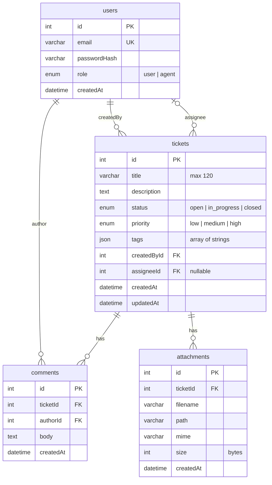

# Entities and core tables (T1.2)

## What it is

The domain model: `User`, `Ticket`, `Comment`, `Attachment`. The tables are created by the migration
`CreateCoreTables` (`apps/api/src/migrations`). All tables are InnoDB, `utf8mb4` / `utf8mb4_unicode_ci`.

## ER diagram

## Files (`apps/api/src`)

- `common/enums.ts` — `UserRole`, `TicketStatus`, `TicketPriority`.
- `users/user.entity.ts`, `tickets/ticket.entity.ts`, `comments/comment.entity.ts`, `attachments/attachment.entity.ts`.
- Entities are discovered by the `**/*.entity.{ts,js}` glob in `database/database.config.ts`; no module registration is needed yet.

## Rules and decisions

- **Foreign keys:** deleting a ticket cascades to its comments and attachments. Deleting a user who created a ticket or wrote a comment is restricted; deleting an assignee sets `assigneeId` to `NULL`.
- **Indexes:** `tickets.status`, `tickets.priority`, `tickets.createdById`, plus the unique `users.email`.
- **Tags:** a JSON array of strings in `tickets.tags` (filtered with `JSON_CONTAINS` in T3.1). There is no database default, because MySQL reports an expression default differently from TypeORM and `migration:generate` would never settle. The service must set `[]` when no tags are given.
- **Password hash:** `passwordHash` has `select: false`, so it is not loaded by default. The login flow selects it explicitly.
- **Defaults:** role `user`, status `open`, priority `medium`.
- Migrations that are merged are never edited; further schema changes get a new migration.
